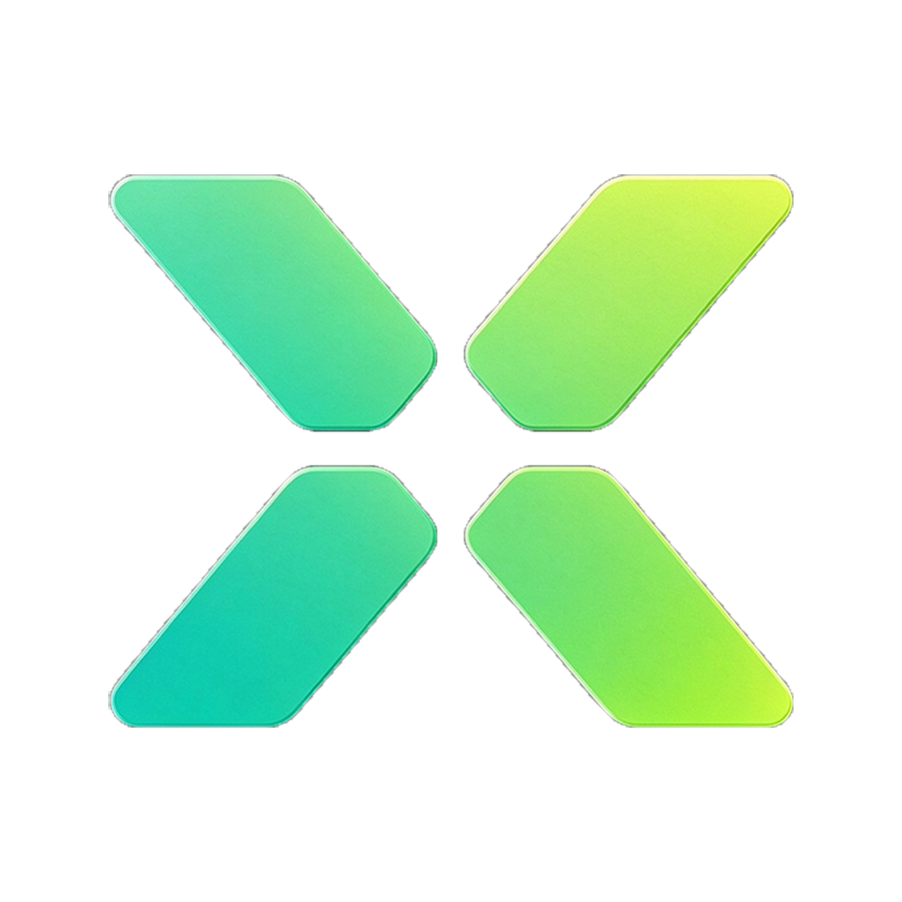

<p align="center">
  
</p>

<h1 align="center">halfsizeX</h1>

**Compress a video to an exact size, locally. No upload, no account, no telemetry.**

[简体中文](README-zh.md) | English

[](./SPEC.md)
[](https://flutter.dev)
[](https://dart.dev)
[](#supported-clients)
[](#supported-clients)
[](#supported-clients)
[](#supported-clients)
[](#ffmpeg-and-licensing)
[](#privacy)
[](LICENSE)
[](https://github.com/YKLovePython/halfsize)
[](#contributing)

halfsizeX is a Flutter rewrite of [YKLovePython/halfsize](https://github.com/YKLovePython/halfsize) (MIT).
It turns a video into a file close to a requested size while keeping the result watchable, and reports
the measured quality instead of  trust a bitrate guess.

The app is a native desktop/mobile GUI. FFmpeg is bundled; processing never leaves the device.

## Why

Most "compress video" tools either ask for a quality number you cannot translate into megabytes, or
produce a file that misses the upload limit. halfsizeX plans the encode from the target size, the
duration, the resolution and the audio budget, then verifies the result with VMAF or SSIM when the
bundled FFmpeg supports it.

## Features

### Implemented

- Exact target size in MB, plus platform presets (Discord, WhatsApp, WeChat, Gmail, Email, Outlook, X).
- Custom target size and optional per-task output filename.
- H.264 (`libx264`) and H.265 (`libx265`) with selectable preset.
- Target-size or CRF quality mode.
- Two-pass size-targeted encoding; automatic retry when the first result overshoots.
- Files already smaller than the target are skipped instead of re-encoded.
- Automatic downscale selection, with an option to keep the original resolution.
- Keep or drop audio; mono/stereo handling and audio bitrate budget.
- HDR (PQ/HLG) detection and HDR-to-SDR tone mapping when the FFmpeg build supports it.
- Progress, speed, ETA, pass number, cancel, and cleanup of partial files.
- Batch queue: select multiple videos, share one setting set, compress serially.
- Task page with per-task detail, retry/cancel, output path, and persisted history.
- Share card export as PNG; native share sheet on Android.
- Desktop FFmpeg repair: SHA-256 verified Windows/Linux/macOS binaries with mirror fallback.
- VMAF / SSIM quality measurement with a human-readable verdict.
- Safe output naming (`name.tag.mp4`, per-task names, collision suffixes) and a configurable output directory.
- Three-tab navigation: Compress, Tasks, Settings.
- Drag and drop on desktop; native file picker on all platforms.
- Embedded video preview on Windows/Linux/macOS: source before encoding, output in task detail; powered by `media_kit`. Linux needs system libmpv2.
- Android foreground service with notification progress; SAF input and MediaStore Downloads output.
- Chinese and English UI; system/dark/light theme; persisted settings.
- Windows MSI installer and portable ZIP.
- Linux AppImage, deb, rpm and portable tarball.
- macOS DMG and ZIP, with FFmpeg bundled.

### Not implemented yet

- Automatic FFmpeg install on macOS (the packaged app bundles it).
- Intel macOS build (current CI publishes arm64).
- Auto-update and file associations.
- Hardware-accelerated encoding (current builds use software x264/x265).
- Subtitle retention.

## Supported clients

| Client | Status | Notes |
|---|---|---|
| Windows x64 | Supported | Release build, MSI + portable ZIP, embedded preview |
| Android arm64-v8a | Supported | Native FFmpeg libraries bundled; foreground service |
| Android armeabi-v7a | Supported | Native FFmpeg libraries bundled |
| Linux x64 | Supported | AppImage, deb, rpm and portable tarball; preview needs system libmpv2 (deb/rpm declare it) |
| macOS arm64 | Supported | DMG and ZIP; FFmpeg bundled; embedded preview; ad-hoc signed unless a Developer ID is configured |

Linux preview uses the system `libmpv`. Install `libmpv2` (or `libmpv1` on older distributions) if the
AppImage or portable build shows no player; the deb and rpm packages pull it in automatically.

## Download

Once a `v*` tag is pushed, the release workflow publishes these artifacts:

- `halfsizeX-<version>-windows-x64.msi`
- `halfsizeX-<version>-windows-x64-portable.zip`
- `halfsizeX-<version>-android-arm64-v8a.apk`
- `halfsizeX-<version>-android-armeabi-v7a.apk`
- `halfsizeX-<version>-linux-x64.AppImage`
- `halfsizeX-<version>-linux-x64.deb`
- `halfsizeX-<version>-linux-x64.rpm`
- `halfsizeX-<version>-linux-x64-portable.tar.gz`
- `halfsizeX-<version>-macos-arm64.dmg`
- `halfsizeX-<version>-macos-arm64.zip`

## Build from source

Requirements: Flutter 3.41+ / Dart 3.11+, and the platform toolchain for your target.

```bash
cd app
flutter pub get
flutter analyze
flutter test
```

### Windows

```powershell
cd app
flutter build windows --release
```

To produce the MSI and portable ZIP, provide a directory containing `ffmpeg.exe`, `ffprobe.exe` and
the FFmpeg DLLs:

```powershell
.\tool\package_windows.ps1 -FfmpegDir C:\path\to\ffmpeg\bin
```

The script needs [WiX](https://wixtoolset.org/) (`dotnet tool install --global wix`).

A Debug run does not contain FFmpeg. It looks in `build/windows/x64/runner/Release/bin`,
`HALFSIZE_FFMPEG`, or the path installed by the Settings repair button. Release packages include
FFmpeg in their `bin` directory.

### Android

```bash
cd app
flutter build apk --release --split-per-abi
```

The Android FFmpeg binaries live in `app/android/app/src/main/jniLibs/<abi>/`. Release signing reads
`android/key.properties` or the `HALFSIZE_KEYSTORE`, `HALFSIZE_STORE_PASSWORD`, `HALFSIZE_KEY_ALIAS`
and `HALFSIZE_KEY_PASSWORD` environment variables. CI uses repository secrets; without a keystore the
build falls back to the debug key.

### Linux

```bash
cd app
sudo apt-get install -y clang cmake ninja-build pkg-config libgtk-3-dev liblzma-dev libstdc++-12-dev libmpv-dev
flutter build linux --release
```

The release workflow then runs `tool/package_linux.sh` to build the AppImage, deb, rpm and portable
tarball. The deb and rpm declare `libmpv2`/`mpv-libs`; AppImage and portable builds need libmpv2
installed on the target system for embedded preview.

### macOS

```bash
cd app
flutter build macos --release
FFMPEG_DIR=/path/to/ffmpeg bash tool/package_macos.sh
```

`FFMPEG_DIR` must contain `ffmpeg`, `ffprobe` and optionally `LICENSE`. The script bundles them in
`Contents/Resources/bin`, signs the app (ad-hoc unless `MACOS_SIGN_IDENTITY` is set), and writes a
DMG and ZIP to `dist/`. CI builds the arm64 package on `macos-15`.

## CI/CD

- `ci.yml` runs `flutter analyze` and `flutter test` on pushes and pull requests.
- `build.yml` builds Android, Windows, Linux and macOS artifacts on manual dispatch and `v*` tags.
- Tag builds publish a GitHub Release with the Android APKs, Windows ZIP/MSI, Linux
  AppImage/deb/rpm/portable tarball, and macOS DMG/ZIP.

Android release signing reads `android/key.properties` or the `HALFSIZE_*` environment variables; CI
uses repository secrets. See the workflow files under `.github/workflows/` for the exact commands.

## Privacy

All probing, planning, encoding and quality measurement run locally. The app has no account, cloud
upload, analytics or telemetry. Network access is only used by the build tooling, not by the app.

## FFmpeg and licensing

halfsizeX itself is MIT-licensed. FFmpeg, x264 and x265 keep their own licenses; redistributed builds
must include the corresponding license texts. See [SPEC.md](SPEC.md) for the intended distribution
and GPL notes. The app never replaces or hides FFmpeg's license.

## Project layout

```text
app/                 Flutter application
  lib/core/          probe, plan, encode, quality, FFmpeg locator/installer, settings
  lib/features/      compress, tasks, settings UI
  android/           Android runner, service, jniLibs
  windows/           Windows runner and installer script
  linux/             Linux runner, desktop entry and icon install rules
  macos/             macOS runner and Xcode project
  tool/              platform packaging scripts
  test/              unit and widget tests
```

## Contributing

Issues and pull requests are welcome. Keep changes small and include a test for behavior changes.
Before opening a PR, run:

```bash
cd app
flutter analyze
flutter test
```

## Credits

- Original project: [YKLovePython/halfsize](https://github.com/YKLovePython/halfsize) (MIT).
- FFmpeg, x264, x265, libvmaf and media_kit.
- Flutter and the Flutter community.
